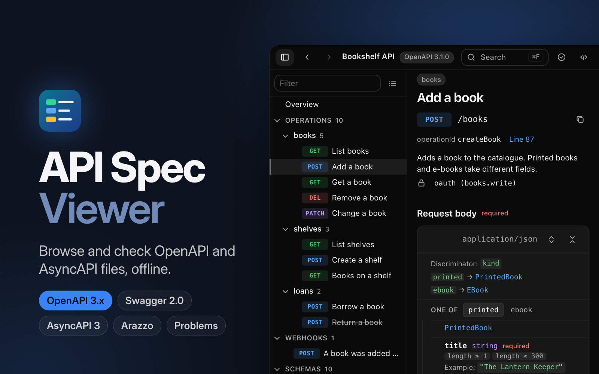

# API Spec Viewer for Orca



An interactive API reference for [Orca](https://orca.dev)'s editor tabs. It reads OpenAPI 3.0, 3.1
and 3.2, Swagger 2.0, AsyncAPI 2.x and 3.x, Arazzo 1.0 and Overlay 1.0 documents in YAML, JSON or
JSON with comments, and shows them as pages you can browse, search and check, without leaving the
editor and without a network.

API Spec Viewer is independent; it is not affiliated with the OpenAPI Initiative, SmartBear
(Swagger) or the AsyncAPI Initiative.

## What opens it

| File                                                                                          | What happens                                    |
| --------------------------------------------------------------------------------------------- | ----------------------------------------------- |
| `openapi`, `swagger`, `asyncapi`, `arazzo` + `.yaml`/`.yml`/`.json` (exact names)             | Opens in **API Spec Viewer** by default          |
| `*.openapi.*`, `*.swagger.*`, `*.oas.*`, `*.oas3.*`, `*.asyncapi.*`, `*.arazzo.*`, `*.overlay.*` with `.yaml`/`.yml`/`.json` | Opens in **API Spec Viewer** by default |
| Any other `.yaml`, `.yml`, `.json`, `.jsonc`                                                  | Opens in Orca's text editor; **API Spec Viewer** is one click away in the view toggle beside Source |

Only the names in the first two rows open in the viewer by themselves. Orca opens plain YAML and
JSON itself, so a plugin can only be offered for them, never take them over. Orca matches exact
file names and suffixes that start with a dot, so `petstore-openapi.yaml` (a hyphen, not a dot),
`api.yaml` or `spec.json` open as text: pick **API Spec Viewer** in the view toggle (Orca keeps
that choice for the open tab only), or rename the file to `petstore.openapi.yaml`.

The viewer reads the content, not the name. A YAML or JSON file that is not an API description
gets a short page that says what it looks like instead (an empty file, a JSON Schema, a
Kubernetes manifest, a `package.json`, a Swagger 1.x file, and so on).

## Features

- **Overview:** title, version, summary and description, contact, licence, terms, external
  docs, servers with their variables, security schemes with OAuth flows and scopes, tags with
  operation counts.
- **Sidebar:** operations by tag (or by `x-tagGroups`), webhooks, and every kind of component;
  for AsyncAPI, operations, channels, servers and messages; for Arazzo, workflows and steps. Method
  badges in colours that read in light and dark themes, deprecated operations struck through, a
  filter, a switch between summaries and paths, and keyboard navigation. Back and forward
  (⌘[ / ⌘], Alt+← / Alt+→, mouse buttons) remember where you were on each page.
- **Search (⌘F or Ctrl+F):** across paths, operationIds, summaries, descriptions, tags,
  component and property names, channels, messages and workflows, with highlighted matches. It
  lists the best 200 matches and says how many there are in all.
- **Operation page:** method and path, summary and description, deprecation, operationId,
  servers that override the root ones, security requirements, parameters by location with
  style, explode and schema, the request body per media type, responses per status with
  headers, links and media types, and callbacks.
- **Schemas:** a tree that opens on demand with types and formats, constraints (length, range,
  pattern, enum, const, default), required, nullable, readOnly, writeOnly and deprecated;
  `allOf` merged into one list, `oneOf` and `anyOf` as tabs named by the discriminator mapping;
  `additionalProperties`, `patternProperties`, `items`, `prefixItems` and examples. A recursive
  schema shows as a link to itself rather than an endless tree. "Expand all" opens a few levels
  and stops at a budget, so even huge schemas stay fast.
- **Examples:** the examples the document gives, each in its own tab, or one generated from the
  schema (marked as generated) when it gives none.
- **Code samples:** curl, JavaScript `fetch`, Python `requests` and HTTPie, built from the
  operation, its first server, security and example body, with copy buttons. Parameters are
  written as their `style`, `explode` or `collectionFormat` says. Every value from the document is
  quoted for the shell and sent as text: an example such as `@notes.txt` never makes curl or
  HTTPie read a local file. An operation whose method is not a valid HTTP method name gets no
  samples, and a NUL, carriage return or stray line break (one a shell command cannot carry
  safely) leaves out the curl and HTTPie samples. API Spec Viewer never sends requests: Orca's
  plugin views have no network, and the page says so instead of offering a "Try it out" button
  that could not work.
- **References:** internal `$ref` and `$dynamicRef` are followed lazily, across chains and cycles,
  as JSON Schema 2020-12 does: `$id` and `$anchor` by URI against OpenAPI 3.2's `$self`, and
  `$dynamicRef` in its dynamic scope. From OpenAPI 3.1 on, a reference's siblings apply (a
  `description` beside a `$ref` overrides, a `maxLength` adds). AsyncAPI traits are merged into
  their messages and operations. A chain of more than 128 references is reported rather than
  followed. References to other files or URLs are shown as external, with the file and the place
  in it. Each component page lists where it is used.
- **Problems panel:** structural checks for the document's version (required and unknown fields,
  wrong types, fields from another version) and lint: unresolved references, duplicate
  operationIds, path parameters that are not declared or not used, equivalent paths, missing or
  no successful responses, unknown security schemes, unused components, `enum`, `default` and
  examples that do not fit their schema, invalid patterns, `minimum` above `maximum`, broken
  discriminators, undeclared tags, and AsyncAPI, Arazzo and Overlay checks. Each problem has its
  line and column and its JSON pointer; click it to open the page, or its line to see the source
  with the problem marked. The source view scrolls sideways; a line longer than 4,000 characters
  shows the part around the problem and says how many characters are left out.
- **Live:** when the file changes (in Orca's text editor or on disk), the view redraws in place
  and keeps the page, scroll position, open tree nodes and tabs.
- **Damaged files:** a file with YAML or JSON errors still shows what could be read, with a banner
  that points at the first error.
- **YAML anchors and aliases** are resolved once. An alias inside the node it names becomes a
  `$ref` to that node, with a warning, and expansion stops at a million values, so a file built to
  blow up gets an error instead of a frozen tab. A file with several YAML documents (`---`) shows
  the first one and says so.
- English and Russian, following Orca's language; light and dark, following Orca's theme.

## Limits

- **Size.** Orca sends a custom editor at most about 50 MiB and shows its own notice for larger
  files. Up to that size the viewer works: a 45 MiB OpenAPI JSON with 12,000 pages opens in about
  0.6 s, a 14 MiB one (GitHub's REST API) in about 0.2 s, and the same API as 10.5 MiB of YAML in
  under a second, with a spinner while it parses. YAML written as short `{ … }` mappings is the
  slowest to read: 8 MiB of them, about 150,000, takes about 1.2 s. Long lists (the sidebar,
  problems, source lines) draw only the rows on screen. The problems panel keeps the first 5,000
  problems and counts the rest.
- **Other files.** Orca gives an editor only the open file, never its path or the files beside
  it, so references to other files cannot load by themselves. They are shown as external, with
  a **Load referenced file…** button and drag-and-drop to add those files by hand for the
  session. This is best-effort: the button opens the system file picker; if your Orca blocks it
  (or a drop), external refs stay listed as links.
- **YAML and JSON messages** come from the parsers and are in English in both languages.
- Read-only: the viewer never edits the file.

## Privacy

No capabilities, no network, no storage. The document stays in the editor frame; links in
descriptions open in your browser only after Orca asks, and images in descriptions are shown as
their alt text, never fetched.

## Install

From the catalog: Orca → Settings → Plugins → ⋯ → **Catalog sources…** → add
`https://github.com/Sergei-Popov/orca-plugin.git`, then install **API Spec Viewer**.

From source:

```sh
git clone https://github.com/Sergei-Popov/orca-api-spec-viewer.git
orca plugin dev load ./orca-api-spec-viewer   # prints the access it needs and an --approve fingerprint
```

`test-files/` has documents to try: `bookshelf.openapi.yaml` (OpenAPI 3.1),
`bookshelf-draft.openapi.yaml` (the same with mistakes for the problems panel),
`greenhouse.asyncapi.yaml` (AsyncAPI 3) and `damaged.openapi.yaml` (a YAML error).

## Develop

No build step: Orca transpiles the TypeScript in `src/` on load.

```sh
orca plugin dev watch . --check   # load, reload on save, stream logs
orca plugin test .                # unit tests (src/**/*.test.ts)
npx -y -p typescript@5.9.3 tsc -p .   # type check (after `orca plugin types .`)
orca plugin check . && orca plugin validate .
orca plugin shot local.api-spec-viewer --editor test-files/bookshelf.openapi.yaml
```

- `src/editor.ts` — the custom editor entry: text document → `App`.
- `src/parse/` — JSON and JSONC (own parser) and YAML (vendored `yaml`) with line positions.
- `src/spec/` — version detection, references, and the OpenAPI, AsyncAPI, Arazzo and Overlay
  models; generated examples and code samples.
- `src/lint/` — the problems engine: per-version structure tables, schema checks and semantic
  rules.
- `src/markdown/` — a small CommonMark and GFM renderer that drops raw HTML and builds DOM nodes,
  never HTML strings. It parses in linear time and caps emphasis nesting and table columns.
- `src/view/` — the sidebar tree and the search index; `src/ui/` — the pages and the shell.
- `tools/rasterize-icons.sh` — makes the icon PNGs from their SVG sources with headless Chrome.

## Licences

The plugin is MIT. It includes [yaml](https://github.com/eemeli/yaml) 2.9.1 by Eemeli Aro (ISC) as
a readable ES module in `vendor/yaml/`; see `vendor/README.md` for its source, hash and rebuild
steps.

Branches follow git-flow: `feature/*` from `develop`, releases through `release/x.y.z` into
`main`, tagged `vX.Y.Z`. Only the maintainers push and open pull requests.
